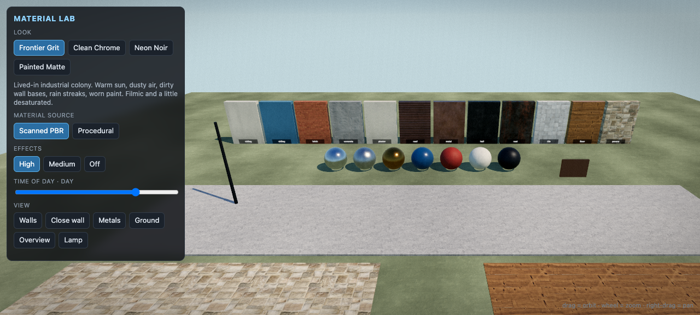
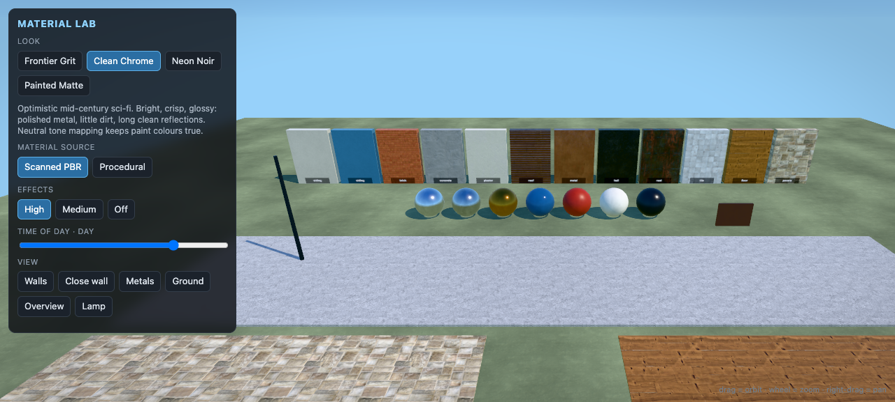
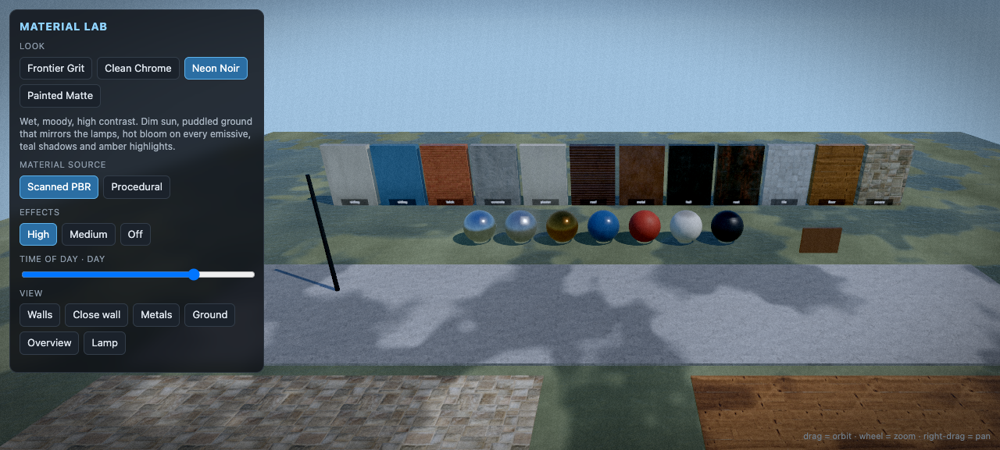
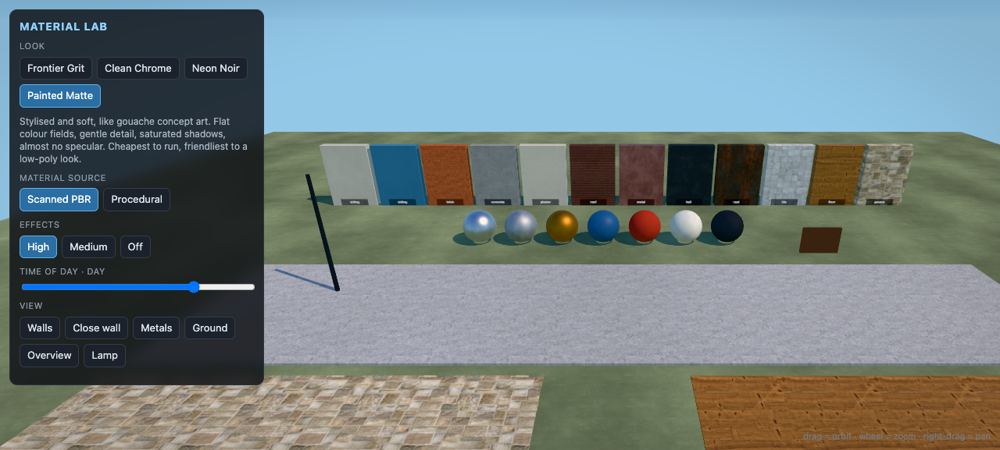
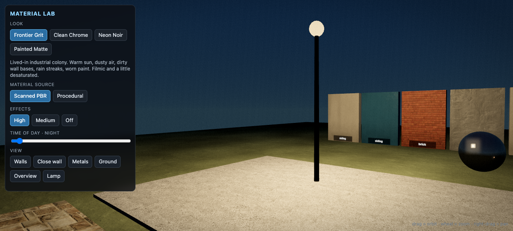
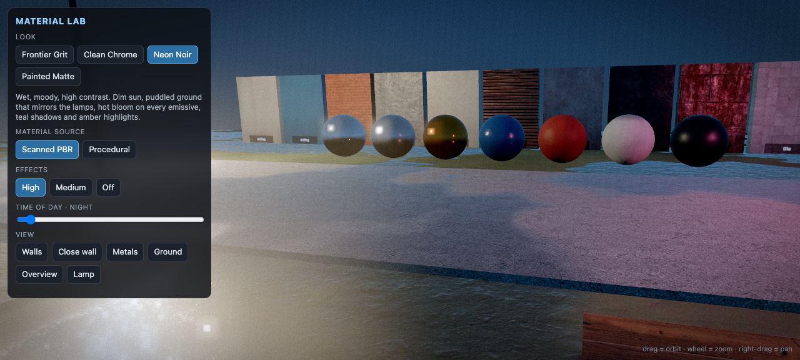

# Rimrunner materials and lighting

## Material kit API (`src/matlib.js`) for wall segments, ships and interiors

One import gives every segment the same palette, the same texel density (**256 px per metre**; 2 m tiles are 512 px) and the same lighting treatment, so neighbouring pieces match. All calls are cached; textures are built lazily on first use (~50-500 ms per style) and shared. Materials go through `Look.dress`, so F6 looks, F7 and F8 keep working and the world-space grime/macro shader applies.

```js
import * as M from './matlib.js';          // or: import { Matlib } from './matlib.js'
```

| Call | What you get |
|---|---|
| `M.panelMat(style, color?)` | PBR material (albedo + normal + roughness + metal + AO). Styles: `panel` (painted 2x2 panels, seams, bolts, scratches), `plate` (heavy riveted plate), `ribbed` (corrugation), `steel` (brushed), `diamond` (tread plate), `concrete` (form-tie holes), `tile` (glazed, dark grout), `carpet`, `wood` (planks), `rubber` (coin studs), `hazard` (yellow/black chipped stripes), `rust` (derelict). `color` tints the albedo (default per style; `hazard`/`rust` default to white = own colours). `M.styleNames()` lists them. |
| `M.uvMeters(geo, matrix?, unit=1)` | Rewrites a geometry's UVs to **world metres** (box projection by dominant normal). **Call this on every geometry that uses `panelMat`.** Pass the mesh's world matrix (or a translation) so the pattern continues across neighbouring segments; skip the matrix for a pattern relative to the piece. A 1 m style repeats every 1 m, 2 m styles every 2 m. |
| `M.emissiveMat(color, mode, {intensity, phase}?)` | Glowing LED/strip/lamp. Modes `led` `strip` `pulse` `blink` `warn` `flicker` `lamp`. One shared material per (colour, mode, phase) animated by the shared loop; boosted ~35% at night; blooms at fx med/high. Use `M.PAL.led.cyan/green/amber/red/white/blue/magenta`. Pass different `phase` to desynchronise blinkers. |
| `M.screenMat(kind, variant=0, intensity=2.0)` / `M.screenTexture(kind, variant)` | Dark glass that emits an animated canvas. Kinds (`M.SCREENS`): `terminal` (scrolling hex, no readable text), `graph`, `radar`, `bars`, `status`, `wave`, `static`, `idle`. `variant` 0-3 = green / cyan / amber / red tint and its own random state. Canvases are 256x160 (aspect 1.6), shared per (kind, variant), redrawn at ~6 Hz in one loop (2 Hz at fx off). Put it on a plane inset into a frame. |
| `M.decalMat(name, {opacity, color, emissive}?)` / `M.decalMesh(name, w, h, o?)` / `M.decalTextures()` | Alpha overlays: `streak` (grime drips), `stripe` (hazard band, 4:1), `vent`, `fan`, `arrow`, `warn` (triangle), `scorch`, `oil`, `plate` (barcode data plate, 2:1), `scratches`, `grime`. Polygon-offset, no depth write: place 2-3 mm off the wall facing +z (planes) and rotate as needed. |
| `M.decalNumber(text, {color}?)` | Stencil number decal (`'04-B'`); `mat.userData.aspect` = width/height of the quad to use. Digits and codes only, never room names. |
| `M.pipeMat(kind, color?)` + `M.pipeGeo(r, len)` | Pipe with flange + bolts every metre and a weld ring. Kinds `steel`, `painted` (default safety orange), `copper`, `insulated`. Pipe axis is +Y; rotate it. |
| `M.wireMat(color)` + `M.cableGeo(a, b, {sag, radius, seg}?)` | Ribbed rubber cable and a sagging tube between two `Vector3`s. |
| `M.glassMat(tint, opacity)` | Clear glass, low roughness, double sided, picks up the sky env. |
| `M.PAL` | Shared palette: `hull hullDark trim ink white cream accent safety teal blue green red rust copper brass carpet wood concrete tile rubber` + `led.*`. Build walls from `hull`/`hullDark`/`trim`/`white`, spend `accent`/`safety`/`led.*` sparingly for life. |

Typical wall: `const geo = M.uvMeters(new THREE.BoxGeometry(w, h, d), mesh.matrixWorld); new THREE.Mesh(geo, M.panelMat('panel', M.PAL.hull))`, then a vent decal, a few `emissiveMat` LEDs, a `screenMat('terminal', 1)` in a `plate` frame, `pipeGeo` runs along the base. Anything built from `emissiveMat/screenMat/decal*` must NOT be merged into a batched static mesh with different materials unless the material instance is kept (batch.js merges by material signature: shared materials stay shared, so animation still works; do not clone them).

Look/lighting additions that apply automatically: cheap contact darkening (wall/floor creases, under overhangs, ceiling occlusion), split-toned colour grade, soft vignette, bloom on emissives at fx **med** (half-res) and **high** (full), night boost on LEDs.

Lab: `lab.html?cam=Kit` (and `Kit close`, `Kit panels`) shows every style, LED mode, screen, decal, pipe, cable and glass.

---

Open `lab.html` (same server, `http://localhost:8765/lab.html`) to flip every option below side by side. In the game: **F6** cycles the look, **F7** the effects tier, **F8** the material source. Or use `?look=noir&fx=high&mat=scan` in the URL. Choices persist in localStorage.

## What was wrong

Every surface was a `MeshStandardMaterial` with a flat 256px canvas texture, no normal map, no roughness map, no environment light, and a hemisphere light standing in for the sky. Metal had nothing to reflect, so it rendered near black. Terrain was vertex colour times one cloud texture. Nothing had dirt, wear or wetness.

## What was researched, and what it gave

| Finding | Where it landed |
|---|---|
| Realism comes from *independent* albedo, normal, roughness and AO channels, not from a better colour map | Every surface kind now has all four (scanned or derived) |
| Colour maps are sRGB, data maps (normal, roughness, ORM) are linear; pack AO/rough/metal into one ORM texture with 4:4:4 JPEG | `tools/prep_materials.py` writes `*_c / *_n / *_o` |
| Image-based lighting matters more than any single light. Prefilter a sky with PMREM and set it as `scene.environment` | `Look.skyEnv()` bakes a procedural sky env, re-baked as the sun moves, faded to ~6% indoors |
| Repetition is the tell of cheap tiling. Break it with world-space macro variation and a second, finer detail scale | `enhance()` multiplies world-space noise into albedo and roughness |
| UV-less batched furniture and terrain can still get scan detail through triplanar sampling | Packed detail textures (`detail_*.png`) sampled in world space |
| Dirt belongs where dirt collects: wall bases, rain streaks down vertical faces, upward-facing puddles | Grime, streak and puddle terms in the same shader patch |
| Tone mapping is an art decision: ACES is punchy and desaturating, AgX holds highlights, Neutral keeps paint colours true | Per-look tone mapper and exposure |
| Bloom on HDR emissives plus a light grade (contrast, saturation, tint, vignette, grain) does a lot for mood | Post stack: MSAA, UnrealBloom, Output, grade pass |
| Screen-space AO (GTAO/SSAO) is the usual contact-shadow trick | **Not used**: the game runs a logarithmic depth buffer (for the 2,000,000 unit far plane) which breaks GTAO's depth reconstruction. See option E |
| Physical lights: indoor spaces need the sky ambient turned off or they glow from outside | `Look.indoor` fades env and hemisphere light when the player is inside a footprint |

Textures are CC0 from [ambientCG](https://ambientcg.com/) (credits in `assets/materials/CREDITS.txt`), about 10 MB for 12 surface sets plus 4 detail layers.

## Surfaces now available (`surfMat(kind, colour)`)

`siding`, `brick`, `concrete`, `metal`, `roof` (corrugated), `floor` (wood), `asphalt`, `pavers`, plus new `hull` (scuffed dark metal), `rust` (corroded plate), `tile` (ship/shop floors), `plaster` (interior walls). The colour you pass is the target average colour; the scan's own average is divided out, so existing building colours still read correctly.

## Option menu

### A. Look (art direction): pick one as default, keep the rest as a setting

| Look | Mood | Tone map | Grime | Wet | Bloom | Best for |
|---|---|---|---|---|---|---|
| **Frontier Grit** (default) | Lived-in industrial colony, dusty, warm sun | ACES | high | none | soft | Rimway as it is written: working town, rough edges |
| **Clean Chrome** | Optimistic mid-century sci-fi, glossy, crisp | Neutral | low | none | light | A cleaner, brighter, more "poster" Rimrunner |
| **Neon Noir** | Rain-slick, teal shadows, hot emissives | AgX | high | puddles | strong | Night play, bar and neon signage, extraction ships |
| **Painted Matte** | Gouache, soft detail, saturated shadows | Neutral | low | none | light | Stylised direction; cheapest; hides low-poly best |








### B. Material source (F8)

| | Scanned PBR (default) | Procedural |
|---|---|---|
| Quality close up | Real depth, wear, pores, scratches | Plausible, soft; maps derived from the old canvas art |
| Cost | ~10 MB download, ~25 MB GPU | none |
| Look | Photographic: may clash with the chunky low-poly models | Consistent with the old art; reads as a better version of what existed |
| Consider | Pair with Frontier or Noir | Pair with Painted Matte |

A hybrid is possible: scans for architecture and ships, procedural for props and terrain.

### C. Effects tier (F7)

`High` MSAA x4 + bloom + grade. `Medium` grade only (no bloom, MSAA stays on the target). `Off` straight to canvas. The game auto-drops a tier if the frame time stays above ~26 ms (never when `?fx=` is pinned).

### D. Further material directions not built yet (each is a separate pass)

1. **Terrain splat**: blend scanned grass, dirt, rock and sand by slope and altitude instead of vertex colour, using the existing triplanar path. Biggest remaining gap outdoors; the ground still reads soft next to the buildings.
2. **Parallax occlusion on bricks, pavers, floor planks**: real depth at grazing angles. Costs about 8 extra samples on those surfaces only.
3. **Decals**: oil stains, scorch marks, blood, bullet holes, painted numbers and hazard stripes, as instanced quads with their own normal and roughness.
4. **Edge wear**: bake curvature into vertex colour on props so paint chips on corners. Needs an offline step per model.
5. **Characters**: skin with subsurface fakery (wrap lighting + thickness), cloth sheen via `MeshPhysicalMaterial.sheen`, and eyes with a wet clearcoat. Characters are deliberately skipped by the new shader (`userData.look.skip`).
6. **Water**: fresnel-blended depth tint, scrolling normals, foam from depth. Today it is a flat plane.
7. **Glass and canopies**: `transmission` with thickness, rain streaks on the cockpit.
8. **Volumetric light**: cheap cone/shaft meshes for lamps and windows at night; fog tinted toward the sun.

### E. Contact shadows / ambient occlusion (needs a decision)

The game uses `logarithmicDepthBuffer` so it can span ship to planet. GTAO/SSAO need linear depth. Options: (1) switch to reversed-Z depth and drop the log buffer (needs a newer three.js with `reverseDepthBuffer`; not verified against r170); (2) keep it and fake AO with baked vertex AO in the interior batcher plus decal blobs under props (cheap, no upgrade); (3) accept none. Recommendation: (2) now, (1) when three is next bumped.

## How it is wired

- `src/look.js`: presets, scan loading, procedural map derivation, material enhancer, PMREM sky env, post stack.
- `src/textures.js`: `surfMat` dresses each material with maps and registers it so F8 can swap source live.
- `src/main.js`: initialises `Look`, routes all four `renderer.render` calls through `Look.render`.
- `src/surface.js`: `Look.surfaceFrame()` each frame: env, light balance, indoor fade, exponential fog.
- `src/people.js`, `src/player.js`: tagged `userData.look.skip` so characters keep their own shading.
- Materials created anywhere (interior kit, terrain, props, ships, extraction) are picked up automatically: `Look.render` patches any new `MeshStandardMaterial` it finds in a scene every ~2.5 s of frames.
- `tools/prep_materials.py` rebuilds `assets/materials/` from ambientCG.

## Known limits

- No controller or touch toggle for F6/F7/F8 yet (keyboard and URL only).
- Extraction ships and the jail get the dim neutral env and the enhancer, but not a bespoke per-room lighting pass.
- Verified headless in a software-rendered browser only; real GPU frame times on the M1 Max are not measured.
